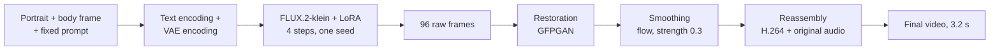
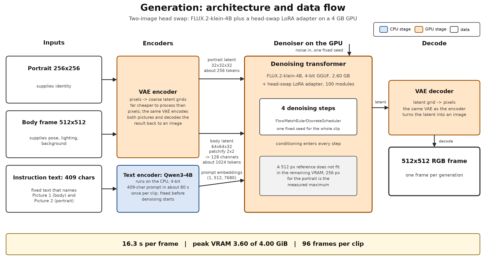
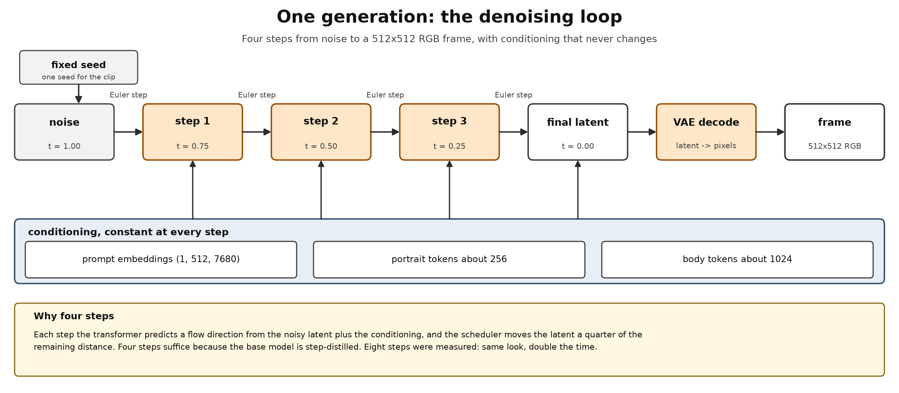

# Diffusion-Based Face Replacement on a 4 GB Laptop GPU

## 1. Scope and constraints

Our goal was to swap the face in a video with one from a selfie. We ran the diffusion model on a system with 4 GB NVIDIA GPU and 8 GB of system RAM. No cloud service was used. The weights of the FLUX.2-klein, Wan 2.2 the head-swap adapter models we used are open source (otherwise we couldn't have used them). The output *should* keep the source motion, expression, lighting, and background, and replace only the head.

## 2. Pipeline overview

The final flow has four stages. Generation makes the frames, restoration cleans each
face, smoothing removes the boil, and reassembly encodes the result with the source
audio. Only the last stage writes a video file; every earlier stage works on PNG frames.

| Stage | Goal | Input | Output |
|---|---|---|---|
| Generation | Transfer identity | Portrait, body frame, prompt | 96 raw frames |
| Restoration | Clean each face | Raw frames | Restored frames |
| Smoothing | Remove the boil | Restored frames | Smoothed frames |
| Reassembly | Encode and attach the sound | Smoothed frames, source audio | Final video, 3.2 s |

The other clips in the package are comparison encodes of the raw, restored and flow-only
frame sets, and each stage was also measured on its own input. Their clips are media 01
to 04, and they are not part of the flow above.

## 3. Generation

This is the stage that actually transfers identity. It has three parts: conditioning,
denoising, and decoding.

**Conditioning.** The instruction is a fixed 409-character text. It names Picture 1 as
the body and Picture 2 as the reference head, and it lists what to preserve from each.
A 4B language model (Qwen3-4B) converts this text into embedding vectors. It runs once
per session on the CPU in 4-bit precision, which takes about 80 seconds, and its memory
is then freed. The text encoder is far larger than the generator, so encoding once and
destroying the encoder is the difference between fitting and not fitting.

Both pictures are compressed by a VAE into coarse latent grids. The compressed form is
far cheaper to process than pixels, and the same VAE decodes the result back to an image.
The body frame is a 512x512 centre crop of the source video, which becomes a 64x64x32
latent grid and about 1024 tokens. The portrait is resized to 256x256 and becomes about
256 tokens; it supplies identity only.

**Denoising.** FLUX.2-klein-4B renders each frame. It starts from noise and refines it
over four steps, guided at every step by the text embeddings and the two image latents.
A community-trained LoRA adapter (100 modules) supplies the head-swap behaviour; it
changes 99.5 percent of the pixels relative to the unadapted model, so it changes the
task, not the style. Four steps are enough because the base model is step-distilled:
eight steps were measured to look the same and to take twice the time.

**Decoding and constraints.** The final latent grid is turned back into pixels by the
same VAE. Two constraints matter. The order of the pictures is part of the model's
contract: reversing them produces a plausible image with the wrong head. And the model
runs as a 4-bit GGUF file of 2.6 GB on the GPU. A 512-pixel reference does not fit in
the remaining memory; 256 pixels is the measured maximum.

**Safety gate.** Before a frame is rendered, a detector counts faces. A frame with more
than one face is refused. The gate has no bypass, so a bystander cannot enter the output.

**Output.** 96 consecutive frames (5.8 to 9.0 seconds of the source), rendered with one
fixed seed. Cost: 16.3 seconds per frame, 26.1 minutes total, peak VRAM 3.60 of 4.00 GiB.

## 4. Face restoration

**Goal.** Give every frame a cleaner face.

**Process.** GFPGAN v1.4 detects the face, aligns a crop, and runs a restoration network
trained to map degraded faces onto clean ones. The restored crop is composited back into
the frame. Weights came from the official release; the network was built in project code
because the published wrappers do not import against the installed vision library. Cost:
0.23 seconds per frame, 1.1 GiB of VRAM.

**Result.** Face change fell from 7.45 to 7.16 (mean) and from 17.38 to 16.21 (p95).
Consecutive identity rose slightly, to 0.927. Identity to the portrait stayed at 0.2153.
Hair noise fell from 32.57 to 32.07. On its own, that is a small effect. Section 5 shows
what it buys the next stage.

**Two findings.** The fidelity weight is inert: the official inference path passes no
weight argument, so runs at 0.7 and 0.9 differ only by the random style draw. And
restoration cannot fix flicker in principle, because it sees one frame at a time and
cannot enforce agreement between frames.

## 5. Temporal smoothing

**Goal.** Remove the boil by comparing frames with each other.

**Method comparison.** Two methods were built and measured at the same strength, 0.6.

The per-pixel deflicker averages each pixel with its temporal neighbours. It is the
cheapest option (0.007 s/frame), and it is too strong: it pushes the face change to
5.63, one full point below the real motion level of 6.66 measured from the unswapped
footage. It removes the boil and part of the real motion.

Optical-flow compensation estimates the dense motion between a frame and its two
neighbours, warps the neighbours into the current frame, and blends them. Because it
follows the same surface point across time, a moving head does not smear. Cost:
0.036 s/frame.

**Calibration.** The control fixes the real motion level at 6.6565, and a smoother can
remove real motion as well as boil. The pass over the raw frames was measured at the
strength that matches the chained pass, and the chained pass was swept over four
strengths:

| Frames smoothed | Strength | Face change | Distance from the control | p95 | Consecutive identity | Hair noise |
|---|---|---|---|---|---|---|
| Raw | 0.3 | 6.9599 | +0.3034 | 16.2944 | 0.9330 | 32.2358 |
| Raw | 0.6 | 6.6663 | +0.0098 | 15.6581 | 0.9391 | 32.0603 |
| Restored, then flow | 0.3 | 6.6303 | -0.0262 | 15.2802 | 0.9377 | 31.7306 |
| Restored, then flow | 0.6 | 6.3071 | -0.3494 | 14.7575 | 0.9431 | 31.5448 |

Two results follow. At the same strength 0.3, restoration is the difference between
removing the boil and not removing it: the raw frames stay 0.30 above the control, and
the restored frames land 0.03 from it. And strength alone can buy a lower number: at
0.6 the chained pass sits 0.35 below the control, which is over-smoothing.

**Result.** The recommended output is the chained set at strength 0.3: face change
6.6303, p95 15.2802, consecutive identity 0.9377, identity to the portrait 0.2152, and
hair noise 31.7306. It matches the control level and it keeps the real motion. Against
the flow-only variant it is better on face change, on the tail and on hair noise; only
consecutive identity is 0.0014 lower. The deflicker variant reaches 5.6269 only by
destroying motion, so flow remains the correct method.

## 6. Reassembly

**Goal.** Encode a frame set into a playable clip.

**Process.** The frames are encoded as H.264 (yuv420p, crf 18) at the source rate of
29.969 fps, and the original audio is muxed back. Video and audio are trimmed to the
same length. Output: a 512x512 clip of 3.203 seconds. The same script is the last stage
of the flow, so the final video is a later run of this encoder.

**Trade-off.** Reassembly cannot change a pixel, and it does not need to. The raw frames
encoded on their own show the problem the two stages above solve: consecutive-frame
identity drops from 0.985 in the real video to 0.923 in the swapped one, and the
face-region change rises from 6.66 to 7.45. The face boils.

## 7. Results

All figures come from the same measurement script on the same 96 frames. Lower face
change and lower hair noise are better; higher identity values are better. The control
is the unswapped source footage.

| Stage | Face change (mean) | Face change (p95) | Consecutive identity | Identity to portrait | Hair noise |
|---|---|---|---|---|---|
| Control, unswapped | 6.66 | 12.35 | 0.985 | -0.036 | 31.60 |
| Raw head swap | 7.45 | 17.38 | 0.923 | 0.215 | 32.57 |
| + restoration | 7.16 | 16.21 | 0.927 | 0.215 | 32.07 |
| + flow on the raw frames | 6.67 | 15.66 | 0.939 | 0.215 | 32.06 |
| + restoration then flow, strength 0.3 (recommended) | 6.63 | 15.28 | 0.938 | 0.215 | 31.73 |
| deflicker (alternative) | 5.63 | 12.67 | 0.936 | 0.211 | 31.90 |

Identity to the portrait confirms the swap direction: the unswapped footage scores
-0.036 against the portrait, and every swapped variant scores near +0.215.

Timing for 96 frames: generation 26.1 minutes, restoration 22 seconds, smoothing
3 seconds, assembly under a second. The recommended chain uses the last two steps, so the
full clip costs about 28 minutes for 3.2 seconds of video; generation is 99.9 percent of
the cost.
**Remaining limitation.** The mean returns to the control level, but the p95 stays at
15.28 against 12.35. A minority of frames still jumps, and no post-processing step
removed that tail, because each operates inside a frame or on a short window.

## 8. Problems encountered and decisions

**Adapter attach order.** Attaching the LoRA before the first forward pass cost 46 to
48 seconds per frame; attaching it after one plain forward pass cost 16 seconds per
frame. Peak VRAM was identical in both cases. We standardised on the fast order and
recorded the effect. The internal cause was not established, but it reproduces exactly,
and it explains an earlier three-fold timing discrepancy in the project notes.

**Flicker is not sampling noise.** The entire clip uses one fixed seed, so the noise
input is constant across frames. The boil still occurs. The cause is the model's
sensitivity to small changes in the input frame. Seed tricks therefore cannot help, and
only a cross-frame pass reduces the boil.

**Memory ceiling.** 512x512 output with a 256-pixel reference peaks at 3.60 of
4.00 GiB. Larger references do not fit the card. A lower output resolution fits, but it
loses detail.

**Native-video probe.** We tried a small native video model (5B, 4-bit) as a direct
alternative. The denoiser loaded, but the text encoder expands from 3.66 GB quantized to
about 11 GB in working precision, beyond the 7.4 GB of system RAM. The first wall on
this machine is system RAM, not VRAM.

## 9. The remaining approach - Wan 2.2 Animate 14B

**Why.** A native video model denoises all frames of a clip together and lets them
influence each other. It never treats frames independently, so the per-frame boil
cannot occur. Wan 2.2 Animate supports a replacement mode: one reference image plus a
driving video yield the swapped video in a single pass.

**Why direct loading fails.** The model has 14 billion parameters. The smallest
quantization of the denoiser alone is 9.87 GiB, and the smallest complete working set
measured 14.01 GiB: 3.5 times the video memory and nearly twice the system RAM.

**The planned route.** ComfyUI, with the ComfyUI-GGUF node, stages the components
instead of holding them at once.

| Component | Role | Size |
|---|---|---|
| Wan2.2-Animate-14B GGUF, Q4_K_S | Denoiser, both expert sets | 9.87 GiB |
| lightx2v I2V step-distill LoRA (rank 64) | Cuts sampling to a few steps | about 1.1 GiB |
| WanAnimate relight LoRA, fp16 | Matches the person to the plate lighting | 1.34 GiB |
| umt5-xxl encoder, fp8 | Prompt conditioning | 6.27 GiB |
| Wan 2.1 VAE | Latent decoding to pixels | 0.24 GiB |
| ComfyUI-GGUF | Loads quantized weights | - |

**Why staging changes the answer.** ComfyUI executes a graph node by node. Its model
manager moves each component into VRAM only when its node runs, and the GGUF loader
dequantizes layer by layer. Peak memory therefore holds a slice of the denoiser instead
of the whole model. The trade-off is throughput: weights stream from memory and disk
during every step, so generation is slow. The distillation adapter lowers the number of
steps and is the main speed lever. The preprocessing chain needs pose estimation, a face
crop, a character mask, and a background plate for the replacement mode. The relight
adapter then blends the generated person into the original lighting.

This is the only remaining route on this hardware that can produce a temporally native
swap. It is planned, not yet measured; every size above is a published file size, not a
runtime measurement.

## 10. Contents of this folder

`REPORT.md` is this report. The media files are numbered in task order:

- `faceswap_01_source_reassembly.mp4` - the raw frames encoded, for comparison: the boil is visible
- `faceswap_02_restored_gfpgan.mp4` - the restored frames encoded, for comparison
- `faceswap_03_smoothed_temporal_flow.mp4` - flow smoothing on the raw frames, for comparison
- `faceswap_04_smoothed_deflicker_comparison.mp4` - the deflicker alternative: shows motion smear
- `faceswap_05_chained_restored_flow.mp4` - the final video from the flow above: restoration then flow
- `faceswap_10_portrait_reference.png` - identity input
- `faceswap_11_body_frame_0175.png` - body input to the model
- `faceswap_12_raw_head_swap_frame_0175.png` - raw generated frame
- `faceswap_13_restored_frame_0175.png` - after restoration
- `faceswap_14_smoothed_frame_0175.png` - after smoothing
- `faceswap_15_contact_sheet.png` - twelve labelled frames from the clip
- `faceswap_16_preview_raw_assembly.gif` - animated preview, raw
- `faceswap_17_preview_smoothed_flow.gif` - animated preview, smoothed
- `faceswap_18_wan_route_feasibility_notes.md` - sizes and sources for the Wan route
- `faceswap_19_preview_chained_restored_flow.gif` - animated preview of the recommended output
- `faceswap_20_metrics_summary.csv` - the measurement table in machine-readable form
- `faceswap_30_generation_architecture.png` - generation stage: inputs, encoders, denoiser, decode
- `faceswap_31_denoising_loop.png` - the four denoising steps and the conditioning
