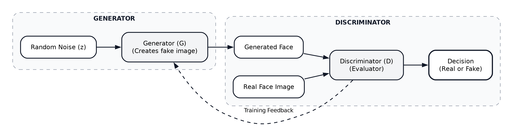
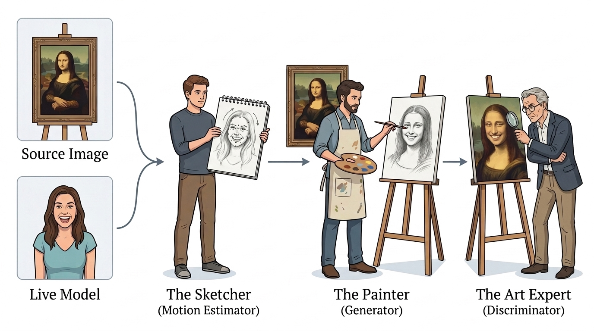

# Standart GAN ve Face Reenactment (Basit Anlatım)
**Tarih / Saat:** 2026-10-10 16:29

## 1. Standart GAN: Ressam ve Uzman Analojisi

- **Generator ($G$):** Hayalinden sıfırdan sahte portre çizen bir ressamdır.
- **Discriminator ($D$):** Tabloya bakıp "Bu gerçek insan mı yoksa çakma mı?" diyen sanat uzmanıdır.
- **Sonuç:** İkisi yarışa girer. Sonunda ressam, dünyada yaşamayan ama gerçek gibi duran yüzler çizmeyi öğrenir.

## 2. Neden Standart GAN Yetmiyor?

Standart GAN piyango gibidir; her seferinde rastgele biri çıkar, kimi çizeceğini kontrol edemezsin. Face Reenactment'ta ise kontrol isteriz:
- **Source Image:** Kimi canlandıracağız? (Örn: Mona Lisa).
- **Driving Video:** Nasıl hareket edecek? (Örn: Bizim kameraya gülümsememiz).

## 3. Face Reenactment: Sipariş Alan Ressam ve Canlı Model Analojisi

Standart GAN'da ressam kafasına göre hayali yüzler çizerken, Face Reenactment'ta ressam sıkı bir sipariş ve canlı bir rehberle çalışır:
- **Orijinal Tablo (Source Image):** Müşterinin ressama getirdiği donuk portre (Örn: Mona Lisa). "Sadece bu kişiyi canlandıracaksın."
- **Canlı Model ve Eskizci (Driving Video & Keypoint/Flow):** Karşıda canlı hareket eden bir model vardır. Eskizci, modelin mimiklerini ve kafa açısını temel çizgilerle (keypoints) yakalayıp ressama tarif eder.
- **Ressam (Generator / Warping & Inpainting):** Orijinal tablodaki yüzü bu eskiz çizgilerine göre büküp yeniden çizer; tabloda hiç olmayan kısımları (arkada kalan kulak, açılan ağızdaki dişler) portrenin ışığına ve tenine uygun şekilde tamamlar.
- **Sanat Uzmanı (Discriminator):** Bitmiş tabloyu inceleyip iki şeyi denetler: "Bu kişi gerçekten portredeki kişi mi?" ve "Mimikler montaj gibi sırıtmadan doğal bir insan gibi akıyor mu?"

*Görsel: Face Reenactment analoji akışı — Canlı Modelin mimiklerini kağıt eskiz defterine aktaran Eskizcinin (Keypoint/Motion), orijinal tabloyla (Source) birlikte Ressama (Generator) yol göstermesi ve Sanat Uzmanının (Discriminator) denetlemesi.*
