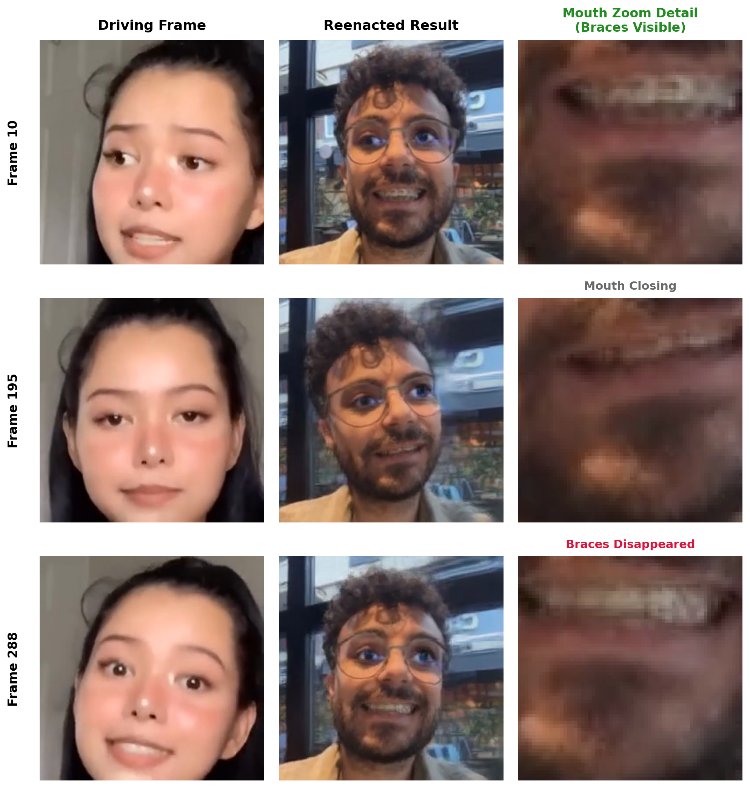

# Diş Teli Deneyi ve Hata Analizi (Failure Mode)
**Tarih / Saat:** 2026-10-10 18:36

## 1. Deney Amacı ve Hipotez
- **Amaç:** Kaynak görselde sıra dışı/nadir bir detay (diş teli) varken ağız açılıp kapandığında modelin dokuyu nasıl koruduğunu test etmek.
- **Hipotez:** Eğitim veri setinde (VoxCeleb) diş teli bulunmadığı için model, inpainting devreye girdiğinde teli silip standart diş dokusu çizecektir.

## 2. Zaman Çizelgesi ve Görsel Kanıt (3x3 Grid)

*Görsel Kaynağı: Yerel deney çıkarımı (outputs/bella_poarch_dis_teli/result.mp4, Frame 10, 195 ve 288 karşılaştırması)*

## 3. Gözlemler ve Teknik İşleyiş

1. **İkili Piksel Üretim Mekanizması:**
   Generator, üretilen her kareyi şu ağırlıklı birleşimle oluşturur:
   $$\text{Output} = (\text{Warped Source} \times O) + (\text{Inpainted Pixels} \times (1 - O))$$

2. **Kare 10 İşleyişi (Warping Rejimi — $O \approx 1$):**
   - Sürüş yüzündeki yer değiştirme düşüktür ($\Delta \text{KP} \approx 0$).
   - Dense Motion Network, kaynak fotoğraftaki ağız piksellerini hedef koordinatlara doğrudan eşler ve $O \approx 1$ üretir.
   - Metal braketler kaynak fotoğraftan birebir kopyalanarak görüntüde yer alır.

3. **Kare 288 İşleyişi (Inpainting Rejimi — $O \approx 0$):**
   - Sürüş yüzündeki geniş ve asimetrik gülümseme optik akış eşleşme sınırını aşar.
   - Dense Motion Network ağız içini $O \approx 0$ olarak maskeler ve kaynak piksellerin aktarımını kapatır.
   - Generator, bu bölgeyi VoxCeleb eğitim ağırlıklarına dayalı öznitelik haritalarıyla sıfırdan sentezler.
   - Eğitim ağırlıkları genel insan yüzü ortalamasını (düz beyaz dişler) kodladığı için diş telleri yerini homojen beyaz diş dokusuna bırakır.

## 4. Teknik Çıkarım
- Model, geometrik eşlemenin korunduğu alanlarda ($O \approx 1$) kaynaktaki özgün detayları aktarır.
- Deformasyonun yüksek olduğu ve inpainting'in devreye girdiği alanlarda ($O \approx 0$) pikselleri eğitim veri setinin istatistiksel dağılımından üretir.
