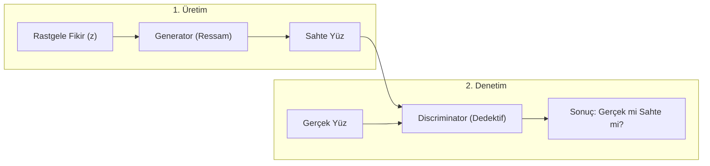

# Standart GAN ve Face Reenactment (Basit Anlatım)
**Tarih / Saat:** 2026-10-10 16:29

## 1. Standart GAN: Sahte Para Basan ve Polis Analojisi

- **Generator ($G$):** Hayalinden sıfırdan sahte portre çizen bir ressamdır.
- **Discriminator ($D$):** Tabloya bakıp "Bu gerçek insan mı yoksa çakma mı?" diyen dedektiftir.
- **Sonuç:** İkisi yarışa girer. Sonunda ressam, dünyada yaşamayan ama gerçek gibi duran yüzler çizmeyi öğrenir.

## 2. Neden Standart GAN Yetmiyor?

Standart GAN piyango gibidir; her seferinde rastgele biri çıkar, kimi çizeceğini kontrol edemezsin. Face Reenactment'ta ise kontrol isteriz:
- **Source Image:** Kimi canlandıracağız? (Örn: Mona Lisa).
- **Driving Video:** Nasıl hareket edecek? (Örn: Bizim kameraya gülümsememiz).

## 3. Kuklacı ve Tiyatro Maskesi Analojisi

- **Tiyatro Maskesi (Source Image):** Elimizde kişinin donuk tek bir vesikalık fotoğrafı var.
- **Kuklacı (Motion Estimator / Keypoints):** Canlı videodaki mimikleri iplerle (yüzdeki görünmez noktalarla) yakalar.
- **Maskeyi Esnetme (Dense Flow / Warping):** Kuklacı ipleri çektikçe fotoğrafı lastik gibi esnetir, gözü kırpar, ağzı büker.
- **Ressam (Generator / Inpainting):** Maske dönünce arkasında kalan kulağı veya açılan ağzın içindeki dişleri hayal edip çizer.
- **Dedektif (Discriminator):** Videonun montaj gibi sırıtıp sırıtmadığını denetler.
