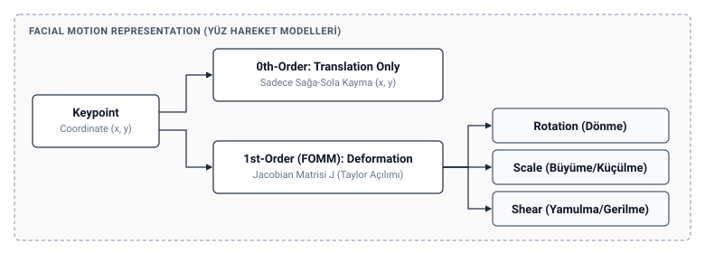

# FOMM Mimarisi (Basit Anlatım)
**Tarih / Saat:** 2026-10-10 16:31

## 1. FOMM Nedir ve Temel Üstünlüğü?
- **Tanım:** Tek bir fotoğrafa (Source), bir videodaki (Driving) kafa hareketlerini ve mimikleri aktaran derin öğrenme tabanlı bir canlandırma sistemidir.
- **Nesneden Bağımsız (Object-Agnostic):** Geleneksel GAN yöntemleri (Face2Face, 3DMM vb.) yalnızca yüzlere özel şablonlara veya manuel landmark etiketlerine bağımlıdır. FOMM ise öncülü Monkey-Net gibi **nesneden tamamen bağımsızdır (*the first object-agnostic deep model family*)**; hiçbir ön-bilgi veya insan müdahalesi olmadan insan yüzü, dans eden tüm vücut veya robot kolları gibi farklı kategorilerdeki her türlü nesneyi canlandırabilir.

## 2. Neden "First Order" Deniyor? (Lastik Çıkartma Mantığı)
- **0. Derece (Eski Usul):** Yüze bir nokta koyup sadece sağa-sola kaydırmak.
- **1. Derece (FOMM):** Noktanın etrafındaki cildin nasıl **döndüğünü, gerildiğini ve esnediğini** de hesaplar (gülerken yanağın gerilmesi gibi).

## 3. Sistem Nasıl Çalışır? (3 Temel Parça)

*Görsel Kaynağı: Siarohin et al., "First Order Motion Model for Image Animation" (NeurIPS 2019)*

1. **Keypoint Detector (Sanal Çıkartmalar):** Yüzde hareketi en iyi ele veren referans noktaları ($K=10$) otomatik bulur.
   - *Çalışma Prensibi:* Hourglass omurgası ısı haritası (*heatmap*) ve türevlenebilir koordinat (*Soft-Argmax*) çıkarır; insan etiketi yerine geometrik eşdeğişirlik (*Equivariance loss*) kuralıyla kendi kendine öğrenir.
2. **Dense Motion Network (Lastik Örtü):** Noktalar arasındaki tüm yüzü birbirine bağlar, resmi lastik gibi çekiştirir ve kafayı çevirince arkada neyin gizlendiğini (**occlusion mask**) anlar.
3. **Generator (Akıllı Ressam):** Fotoğrafı esnetir (**warp**) ve görünmeyen yerleri (açılan ağızdaki dişler, dönen kulak) uydurup boyar (**inpainting**).
