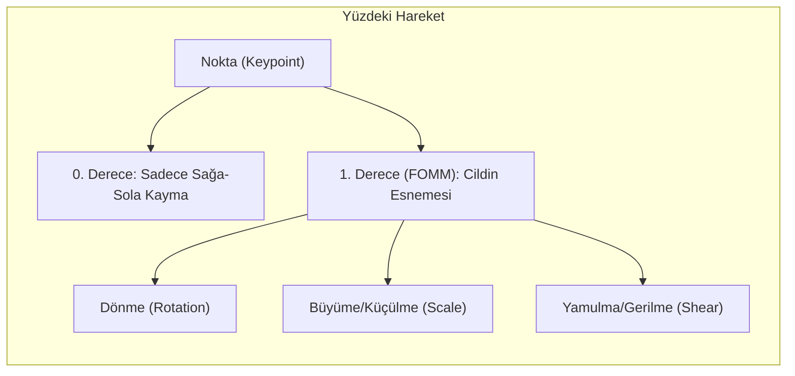
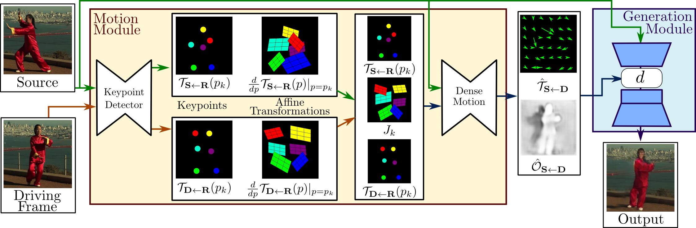

# FOMM Mimarisi (Basit Anlatım)
**Tarih / Saat:** 2026-10-10 16:31

## 1. FOMM Nedir?
Tek bir fotoğrafa (Source), bir videodaki (Driving) kafa hareketlerini ve mimikleri aktaran akıllı bir kuklacı sistemidir.

## 2. Neden "First Order" Deniyor? (Lastik Çıkartma Mantığı)
- **0. Derece (Eski Usul):** Yüze bir nokta koyup sadece sağa-sola kaydırmak.
- **1. Derece (FOMM):** Noktanın etrafındaki cildin nasıl **döndüğünü, gerildiğini ve esnediğini** de hesaplar (gülerken yanağın gerilmesi gibi).

## 3. Sistem Nasıl Çalışır? (3 Temel Parça)

*Görsel Kaynağı: Siarohin et al., "First Order Motion Model for Image Animation" (NeurIPS 2019)*

1. **Keypoint Detector (Sanal Çıkartmalar):** Yüzde hareketi en iyi ele veren 10-20 noktayı otomatik bulur (insan müdahalesi gerekmez).
2. **Dense Motion Network (Lastik Örtü):** Noktalar arasındaki tüm yüzü birbirine bağlar, resmi lastik gibi çekiştirir ve kafayı çevirince arkada neyin gizlendiğini (**occlusion mask**) anlar.
3. **Generator (Akıllı Ressam):** Fotoğrafı esnetir (**warp**) ve görünmeyen yerleri (açılan ağızdaki dişler, dönen kulak) uydurup boyar (**inpainting**).

## 4. Model Nasıl Eğitilir? (3 Büyük Sınav)
- **Perceptual Loss:** "Büyük resimde gerçekten o kişiye benzedi mi?" testi.
- **Equivariance Loss:** "Fotoğrafı yan çevirsem de çıkartmaları doğru yere koyabiliyor musun?" testi.
- **Adversarial Loss:** "Görüntü bulanık mı yoksa gerçek bir video gibi net mi?" testi.
