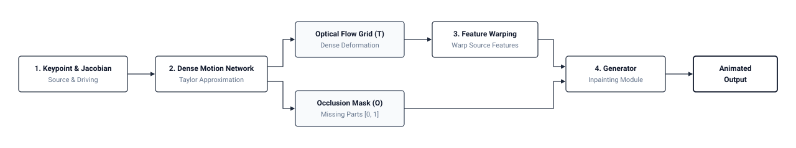
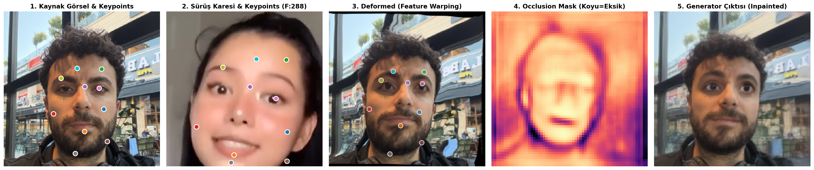

# FOMM Teknik İşleyişi
**Tarih / Saat:** 2026-10-10 17:02

## 1. Keypoint ve Türev Mantığı

Model, yüzdeki kritik hareket noktalarını (Keypoint) tespit ederken iki bilgi çıkarır:
1. **Konum (x, y):** Noktanın ekranda tam nerede olduğu.
2. **Yerel Değişim / Türev (Jacobian):** Noktanın etrafındaki dokunun hareket yönü.
   - Sadece noktanın kayması değil; o bölgenin **açısal dönüşü (rotation)**, **büyüyüp küçülmesi (scale)** ve **esnemesi (shear)** 4 parametrelik bir matrisle takip edilir.

## 2. Neden 1. Derece (First-Order)?

- **0. Derece Yaklaşım:** Noktayı sadece $(x, y)$'den $(x', y')$'ye taşır. Derinin bükülmesini hesaba katamaz, sonuç robotik ve sert olur.
- **1. Derece Yaklaşım:** Noktayı taşırken, çevresindeki pikselleri de türev bilgisine göre eğer ve büker. Mimikler bu sayede organik akar.

## 3. Sistem Akışı (Pipeline)

## 4. Modüllerin Görevleri

1. **Keypoint Detector:** Yüzde hareketi en iyi açıklayan 10-20 referans noktayı ve yerel esneme katsayılarını otomatik bulur.
2. **Dense Motion Network:** Ayrık noktaları tüm yüzeyle birleştirip genel bir hareket ızgarası üretir. Ayrıca kafa döndüğünde görünmeyen alanları (occlusion) belirler.
3. **Generator:** Kaynak fotoğrafın katmanlarını hareket ızgarasına göre kaydırır; fotoğrafta olmayan alanları (açılan ağız içi vb.) gerçekçi şekilde tamamlayıp son kareyi üretir.

## 5. Çıkarım Sırasındaki Ara Aşamalar (Görsel Kanıt)

*Görsel: Yerel çıkarım ara aşamaları (1. Kaynak Keypoint'leri, 2. Sürüş Keypoint'leri, 3. Deformed Warping, 4. Occlusion Maskesi, 5. Inpainting Çıktısı)*
