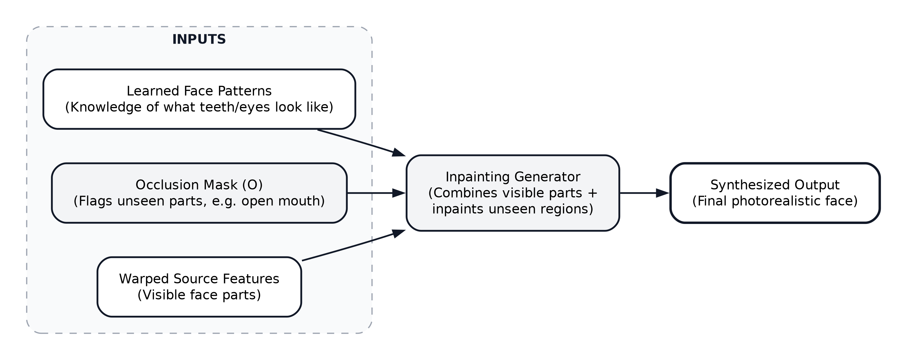

# Occlusion ve Inpainting (Görünmeyen Alanların Doldurulması)
**Tarih / Saat:** 2026-10-10 17:13

## 1. Problem: Kaynakta Olmayan Pikseller (Self-Occlusion)

Kaynak fotoğrafta (Source) ağız kapalıyken veya yüz tam karşıya bakarken; sürüş videosunda (Driving) ağız açılabilir ya da kafa dönebilir. Bu durumda kaynak fotoğrafta diş, dil veya dönen kulağın pikselleri fiziksel olarak mevcut değildir.

## 2. Aşama 1: Kapanma Tespiti (Occlusion Mask)

Dense Motion Network, pikselleri sadece kaydırmaz; her bölge için bir **Occlusion Mask** üretir:
- **1 (Görünür / Güvenli):** Kaynak fotoğrafta var olan pikseller (göz, burun, alın). Warping ile doğrudan taşınır.
- **0 (Kapanmış / Eksik):** Kaynakta bulunmayan yeni alanlar (açılan ağız içi, kafanın arkası). Model buraları delik/boşluk olarak işaretler.

## 3. Aşama 2: Eksik Alanları Çizme (Inpainting)

Generator, eğitim sırasında milyonlarca yüz videosundan insan anatomisini öğrenmiştir:
1. Deliğin büyüklüğünü ve açısını inceler.
2. Kaynak kişinin ten rengi, dudak yapısı ve ışık açısıyla uyumlu dokuları sıfırdan çizer (**Inpainting / Hallucination**).

## 4. Hata Durumları (Failure Modes)

- **Kişiye Özel Detaylar:** Model kaynak fotoğrafta göremediği detayları (diş teli, kırık diş) bilemez; ortalama standart bir diş üretir.
- **Aşırı Açı Değişimi:** Kafa $45^\circ$'den fazla döndüğünde boşluk çok büyür; model alanı tam uyduramaz ve bulanık lekeler (artifacts) oluşur.

