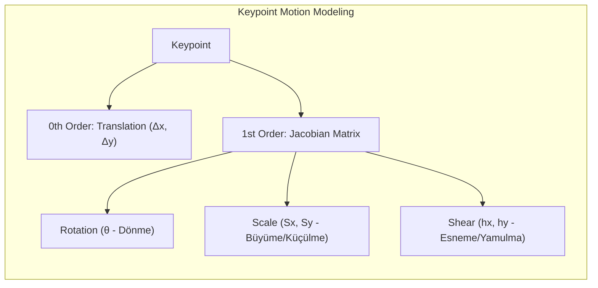

# First Order Motion Model (FOMM)

## 1. Tanım ve Amaç
- **Paper:** Aliaksandr Siarohin et al. (NeurIPS 2019).
- **Amaç:** Tek bir **Source Image**'ı (identity), bir **Driving Video**'dan (motion) gelen pose ve expression ile canlandırmak (one-shot reenactment).

## 2. Neden "First Order"? (Local Affine Transformation)
- Standart modeller hareketi sadece 0th-order translation $(x, y) \rightarrow (x', y')$ olarak görür.
- FOMM, her keypoint etrafındaki local motion'ı **1st-order Taylor expansion (Jacobian)** ile modeller.

## 3. Temel Pipeline ve Modüller

*Görsel Kaynağı: Siarohin et al., "First Order Motion Model for Image Animation" (NeurIPS 2019)*

1. **Unsupervised Keypoint Detector:** Predefined landmark gerektirmez. $K$ adet keypoint ve local Jacobian matrislerini çıkarır.
2. **Dense Motion Network:** Sparse hareketlerden tam bir **Dense Flow / Deformation Field** ve **Occlusion Mask** üretir.
3. **Occlusion-aware Generator:** Feature'ları dense flow ile **warp** eder, görünmeyen kısımları **inpainting** ile tamamlar.

## 4. Loss Fonksiyonları
- **Perceptual Loss (VGG-19):** Multi-scale feature matching ile semantic kalite.
- **Equivariance Loss:** Keypoint'lerin geometric transformation tutarlılığı.
- **Adversarial Loss (GAN):** PatchGAN discriminator ile photorealistic keskinlik.
