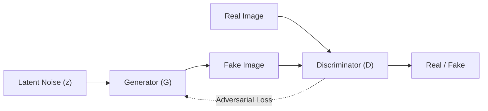

# Standart GAN ve Face Reenactment

## 1. Standart GAN: Sahtekar Ressam ve Sanat Eksperi

- **Generator ($G$):** Latent space'ten ($z$) sıfırdan sahte bir portre üretir.
- **Discriminator ($D$):** Görüntünün gerçek mi sahte mi olduğunu classify eder.
- **Sonuç:** Min-max adversarial training ile photorealistic ama kontrolsüz rastgele yüzler üretir.

## 2. Face Reenactment İhtiyacı ve Yöntem

Standart GAN rastgele çıktı verir, kontrol edilemez. Face Reenactment'ta iki girdi vardır:
1. **Source Image:** Korunacak identity ve appearance.
2. **Driving Video / Frame:** Aktarılacak pose, expression ve motion.

**Kullanılan Mimari:** Conditional GAN (cGAN) ve motion-guided modeller (örn. FOMM).

## 3. Analojinin Uyarlanması: Tiyatro Maskesi ve Kuklacı

- **Girdi:** Ressam artık sıfırdan çizmez; elinde donuk bir **maske** (Source Image) vardır.
- **Kuklacı (Motion Estimator / Keypoints):** Aktörün (Driving) hareketlerini **keypoint**'ler ve Jacobian'larla yakalar.
- **Maskeyi Esnetme (Dense Flow / Warping):** Kuklacı, aktörün hareketine göre kaynak maskeyi warp eder.
- **Tamamlayıcı Ressam (Generator / Inpainting):** Maske döndüğünde görünmeyen alanları inpainting ile tamamlar.
- **Eksper (Discriminator):** Sentezlenen çerçevenin doğallığını ve kalitesini denetler.

## 4. Temel Pipeline Özeti

- **Motion Extraction:** Keypoint detection ve motion estimation.
- **Dense Flow & Occlusion Map:** Warping alanının ve kapanan bölgelerin tespiti.
- **Generation:** Warped feature'ların inpainting ve refinement ile sentezlenmesi.
